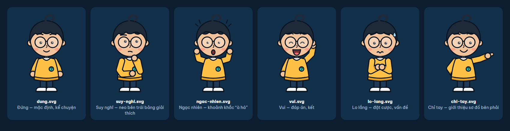

# Tò — nhân vật chính của kênh

Dáng chibi (đầu ~45 % chiều cao), người trẻ trung tính, kính tròn, lọn tóc xoăn hình dấu hỏi, áo len vàng có huy hiệu "?" xanh ngọc.
Đóng vai "bạn" trong phần kể chuyện và đứng neo bên trái bảng giải thích.



## Tư thế

| File | Dùng khi |
|------|----------|
| `dung.svg` | Mặc định, kể chuyện |
| `suy-nghi.svg` | Neo bên trái bảng giải thích (tư thế dùng nhiều nhất) |
| `ngac-nhien.svg` | Khoảnh khắc "à há", phát hiện bất ngờ |
| `vui.svg` | Đáp án, kết |
| `lo-lang.svg` | Đặt cược, nêu vấn đề |
| `chi-tay.svg` | Giới thiệu sơ đồ ở bên phải |

Muốn sửa hay thêm tư thế: sửa `tao-tu-the.py` (bảng `ARMS`, `FACES`, `POSES`) rồi chạy
`py assets\nhan-vat\to\tao-tu-the.py`. Không sửa tay các file `.svg` — lần chạy sau sẽ ghi đè.

## Kích thước và mốc tọa độ

- viewBox `0 0 440 540`, nhân vật cao ~480 đơn vị, chân chạm đất ở y = 502.
- Trong cảnh bảng 1920×1080: đặt khung 600×736 ở `left: 80px; top: 260px` (chân chạm y ≈ 944 px).
- Mốc xoay (`svgOrigin`, tọa độ bên trong nhóm `.to`): cổ `180 280` · mắt `180 199` · vai trái `130 312` · vai phải `230 312` · thân `180 500` · chân `180 502`.
- Trong tập thật, đặt SVG nhân vật bên trong cảnh con (sub-composition) của cảnh đó, không đặt thẳng ở `index.html` gốc — `hyperframes check` sẽ cảnh báo `nested_structure_needs_subcomposition`.

## Bộ phận để diễn hoạt

Mỗi SVG có gốc `id="to-<tư-thế>"` (VD `#to-suy-nghi`) và các class:

| Class | Diễn hoạt |
|-------|-----------|
| `.dau` | nghiêng (`rotation`, origin `180 280`), gật, nhấp nhô khi thở |
| `.than` | thở: `scaleY` 1 → 1,012, origin `180 500` |
| `.tay-trai`, `.tay-phai` | xoay quanh vai |
| `.mat` | chớp: `scaleY` 1 → 0,1 → 1 trong ~0,15 s; liếc: `x` |
| `.long-may` | nhướng: `y` −5 |
| `.mieng` / `.mieng-noi` | nói: bật tắt `opacity` hai nhóm theo chữ trong `audio\words.json` |
| `.them` | chi tiết của biểu cảm (giọt mồ hôi, vạch ngạc nhiên) |

Phải **nhúng thẳng SVG vào HTML** (không dùng ``) thì mới điều khiển được từng bộ phận.

## Quy tắc diễn

- Đổi tư thế qua một nhịp: nhún lấy đà (~0,12 s, `scaleY` 0,97) → hòa hai tư thế (~0,12 s) → nảy về (`back.out`, ~0,45 s). Không nhảy cụt từ tư thế này sang tư thế khác.
- Đầu đi trước, tay theo sau; không cử động hai tay hay hai mắt cùng lúc, cùng lượng.
- Luôn có sự sống khi đứng yên: thở, chớp mắt mỗi 2–4 giây (khoảng cách không đều).
- Mắt nhìn về thứ đang được nói tới trên bảng.

`thu-dien-hoat.mp4` là clip thử 6 giây: thở, chớp mắt, nói, nhấc tay, rồi chuyển sang tư thế suy nghĩ.

```js
// Mẫu GSAP trong composition
tl.to("#to-dung .mat", { scaleY: 0.1, svgOrigin: "180 199", duration: 0.06 }, 1.25)
  .to("#to-dung .mat", { scaleY: 1, svgOrigin: "180 199", duration: 0.09 }, 1.31);
tl.set("#to-dung .mieng", { opacity: 0 }, 0.45).set("#to-dung .mieng-noi", { opacity: 1 }, 0.45)
  .set("#to-dung .mieng-noi", { opacity: 0 }, 0.6).set("#to-dung .mieng", { opacity: 1 }, 0.6);
```
